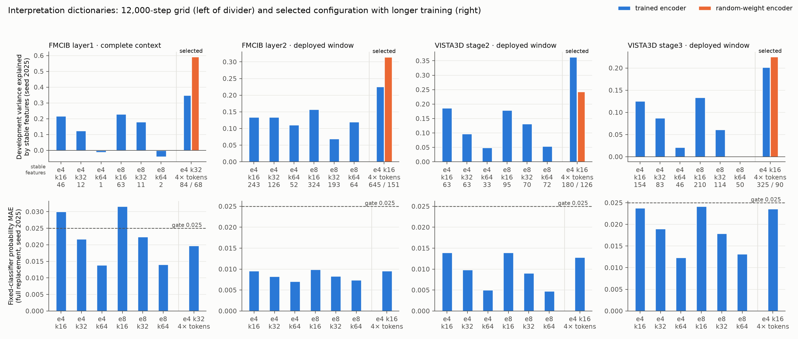

# SAE dictionaries for feature interpretation

Four representation sites provide the dictionaries for the feature-interpretation
step: FMCIB layer1 restricted to positions whose 35-voxel receptive field lies
inside the source field of view (84 mm nodule-centered input), FMCIB layer2, and
VISTA3D stage2 and stage3 on their deployed input windows. Each site has eight
training seeds (2025–2032) on the trained encoder and eight on a same-architecture
random-weight encoder with identical preprocessing, sampling and SAE settings.

| Site | Configuration | Stable features per seed, trained / random | Variance explained by stable features, trained / random | FVU (matched-rank PCA) | Probability MAE, 8 seeds | Recovered AUROC (original) |
|---|---|---|---|---|---|---|
| FMCIB layer1, complete context | e4 k32, 2,048 features | 81–96 / 60–77 | 0.349 / 0.591 | 0.121–0.122 (0.334) | 0.0195–0.0219 | 0.878–0.881 (0.882) |
| FMCIB layer2 | e4 k16, 4,096 | 617–662 / 134–163 | 0.226 / 0.314 | 0.269–0.270 (0.564) | 0.0096–0.0101 | 0.882–0.885 (0.882) |
| VISTA3D stage2 | e4 k16, 768 | 172–198 / 119–127 | 0.363 / 0.243 | 0.269–0.270 (0.581) | 0.0127–0.0142 | 0.880–0.885 (0.885) |
| VISTA3D stage3 | e4 k16, 1,536 | 317–335 / 87–93 | 0.201 / 0.225 | 0.389–0.390 (0.729) | 0.0230–0.0249 | 0.878–0.884 (0.885) |

A feature is stable when a feature with decoder cosine at least 0.7 exists in at
least six of the seven other seeds and it is active on development data. Variance
explained by stable features uses the reference seed (2025) and development
vectors. Probability MAE and AUROC come from the fixed classifier after replacing
the entire deployed map by its reconstruction (1,285 development records); the
acceptance limits are MAE 0.025, AUROC decrease 0.01 and AP decrease 0.02. Replacing
only the complete-context positions of FMCIB layer1 gives MAE 0.0050–0.0057.

## Configuration and training length

The initial grid (k 16/32/64 × expansion 4/8, 12,000 steps of 2,048 vectors, eight
seeds) showed that cross-seed reappearance falls as k rises at every site. Each site
uses the smallest k whose reference-seed dictionary passes the classifier checks:
k16 fails for FMCIB layer1 complete context (MAE 0.030), so that site uses k32.
Expansion 8 changed the variance explained by stable features by −0.008 to +0.056
without a consistent direction and doubles the features, so all sites use
expansion 4.

Training longer on the same matrices raised reproducibility at every site
(seeds 2025–2028, features that reappear in all three other seeds):

| Site, e4 k16 | 12,000 steps | 48,000 steps | 192,000 steps |
|---|---|---|---|
| FMCIB layer1, complete context | 53–66 | 159–162 | 317–325 |
| FMCIB layer2 | 260–274 | 644–659 | |
| VISTA3D stage2 | 65–72 | 174–181 | |
| VISTA3D stage3 | 153–171 | 309–328 | |

All selected dictionaries use 48,000 steps. The 192,000-step result shows that
reproducibility continues to rise with more training.

## Comparison with the random-weight encoder

The trained encoder yields 4.3 times (layer2), 3.6 times (stage3), 1.4 times
(stage2) and 1.2 times (FMCIB layer1 complete context) as many stable features as
the random-weight encoder at the reference seed. The random encoder's
representation is simpler, so fewer stable features explain more of its variance;
that quantity is not comparable between encoders. Stable FMCIB layer1
complete-context features are close to the random network's in number and nodule
enrichment, so interpretations at that site require feature-by-feature comparison
with the random dictionaries.

`production_summary.json` lists, per site, how many reference-seed stable features
exceed the 95th percentile of random-encoder features in nodule-region enrichment
(0, 29, 11 and 11 for the four sites) and in size-adjusted malignancy association
in both patient groups with the same sign (3, 23, 13 and 8). These are descriptive
screens without multiple-comparison correction. Nodule log volume alone reaches
development AUROC 0.808 with one record per patient.

## Files

- `configurations.csv`: initial grid, trained and random rows, stability and
  classifier metrics for seed 2025.
- `training_length.csv`: training-length diagnostic.
- `selected_configurations.csv`: the four selected configurations and their
  random-encoder controls.
- `selected.csv`: all 64 dictionaries (four sites × eight seeds × two encoders).
- `reappearance_distribution.csv`: per-feature reappearance counts for the
  reference seed of each selected configuration.
- `production_summary.json`: per-site summary above.
- `nodule_reference_summary.json`: model-independent nodule measurements.
- `provenance.json`: hashes of the selection record, viewer index, configuration
  and export code.

## Evaluation scope

Training uses 3,729 records from 1,264 patients; development uses 1,285 records
from 422 patients. Feature statistics use one nodule record per patient. The
1,118-record independent test partition remains unused. Dictionaries, weights and
per-patient values stay in private storage; configuration
`configs/sae_interpretation.json` and the code under `src/sclvmi/sae_interp_*.py`
and `src/sclvmi/sae_context.py` reproduce them.
