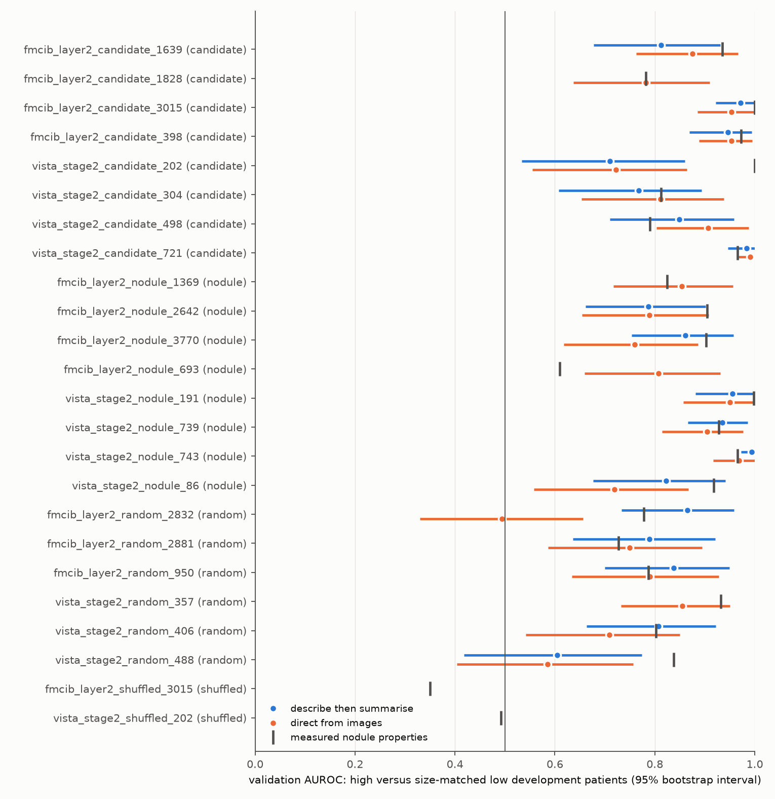
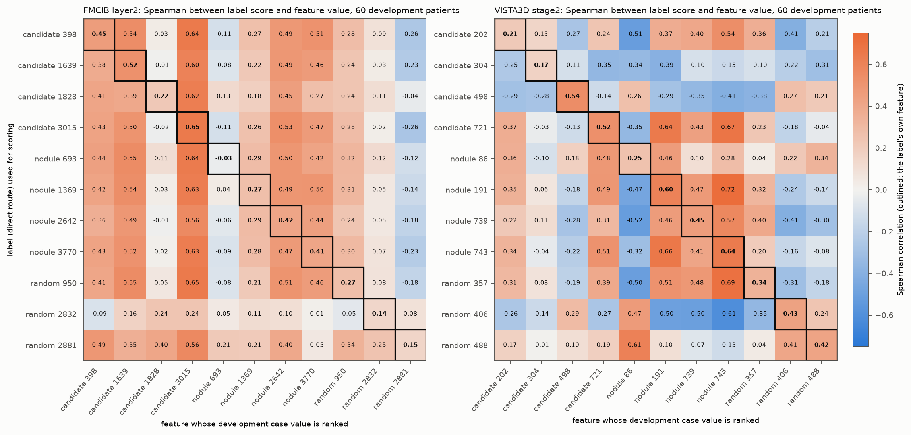

# Automatic interpretation pilot

Can a general vision-language model, given fixed CT examples, write descriptions of SAE features that predict the feature's response in held-out patients? The pilot also checks whether the descriptions say more than size-matched contrasts, random-weight controls, shuffled groups and measured nodule properties already show. Run `20261015_autointerp_pilot`, model `gpt-6.1-sol` (OpenAI Responses API with structured outputs). The independent test set is unused.

## Design

- **Features** (reference seed 2025 of the [nodule-interpretation dictionaries](../20261015_sae_nodule_coverage/README.md)), per site (FMCIB layer2, VISTA3D stage2):
  - 4 confirmed malignancy candidates from [the candidate run](../20261015_feature_candidates_nodule/README.md), one per correlated group;
  - 4 other nodule-enriched stable features;
  - 3 stable random-weight encoder features;
  - 1 shuffled control: the first candidate's case values permuted within each split, with images unchanged.
- **Examples:** the case value is the feature's maximum within 4 mm of the nodule.
  - Generation uses 12 training patients with the highest values and 12 training patients with low values (at or below the 20th percentile), each matched to a high patient on log nodule volume (mean absolute difference 0.35).
  - Validation uses 20 + 20 development patients chosen the same way.
- **Images:** three orthogonal planes through the nodule centre (50 mm FMCIB, 72 mm VISTA3D windows), lung and mediastinal windows, 10 mm scale bar. Generation images add a row with the activation overlay.
- **Two routes to a label:**
  - describe each generation image, then summarise the high-versus-low difference from the text;
  - read all 24 images at once ("direct").

  The model may return "no clear pattern".
- **Validation:** a separate call scores each validation image (plain CT rows, no overlay, no activation values) 0–10 against the label. The metric is AUROC of the score for high versus low patients, with a 95% patient bootstrap interval.
- **Baselines:**
  - measured nodule properties: a ridge model of the case value on log volume and eight nodule measurements, fitted on training patients, evaluated on the same validation sets;
  - specificity: on a fixed panel of 60 development patients per site, every direct-route label is scored, and its scores are correlated with every feature's case value.

## Results

| Features | Route | Labelled | Interval above 0.5 | Median AUROC | Median measured-property AUROC |
|---|---|---:|---:|---:|---:|
| Candidates (8) | describe, summarise | 7 | 7 | 0.85 | 0.95 |
| Candidates (8) | direct | 8 | 8 | 0.89 | 0.95 |
| Nodule-enriched (8) | describe, summarise | 6 | 6 | 0.90 | 0.91 |
| Nodule-enriched (8) | direct | 8 | 8 | 0.83 | 0.91 |
| Random-weight (6) | describe, summarise | 5 | 4 | 0.81 | 0.80 |
| Random-weight (6) | direct | 6 | 4 | 0.73 | 0.80 |
| Shuffled (2) | both | 0 | — | — | 0.42 |

- **Shuffled controls:** both routes return "no clear pattern"; no label was invented for random groupings.
- **Generic labels:** most trained-encoder labels describe the same contrast, a discrete solid nodule surrounded by aerated lung versus a nodule attached to pleura, diaphragm or other soft tissue. The random-weight features receive similar labels with a similar validation AUROC.
- **Measured properties:** for 25 of 40 labels, the label's AUROC does not exceed the measured-property baseline.

- **Specificity, FMCIB layer2:** labels are interchangeable; each label ranks patients for the whole group of "free solid nodule" features about equally.
- **Specificity, VISTA3D stage2:** two labels are specific to their feature:
  - feature 498, "basal lung beside the diaphragmatic dome": Spearman 0.54 with its own feature, negative with the free-nodule features; validation AUROC 0.91 [0.80, 0.99] against a measured-property baseline of 0.79;
  - feature 304, "hazy nodule with a small dense core": highest for its own feature but weak, ρ 0.17.
- **Specificity, overall:** the label's own feature ranks first for 3 of 22 labels (median rank 4 of 11). The mean Spearman is 0.37 with the label's own feature and 0.15 with the other features.

## Conclusion

The route runs end to end:
- 3,544 calls with no refusal or format failure, total cost 9.81 USD;
- saved, resumable outputs;
- the shuffled controls behave as nulls;
- descriptions predict feature responses in held-out patients.

At this contrast, though, the descriptions mostly name a coarse nodule type and location that measured properties and random-weight features already capture; they rarely separate one feature from another. Feature-level interpretation needs harder contrasts, for example low examples matched on pleural contact and solidity as well as size, or active examples of the same nodule type. Medical names in the labels are model output and need human review.

## Files

| File | Content |
|---|---|
| [validation.csv](validation.csv) | per feature and route: label, description, validation AUROC and interval, Spearman, mean scores, measured-property AUROC |
| [summary_by_role.csv](summary_by_role.csv) | counts and medians per feature role and route |
| [specificity.csv](specificity.csv) | Spearman between each label's scores and each feature's case value on the 60-patient panels |
| [provenance.json](provenance.json) | settings, prompts, model, call counts and costs, code hashes |

Code: [sae_autointerp.py](../../src/sclvmi/sae_autointerp.py) (selection, rendering, measured-property baseline), [sae_autointerp_model.py](../../src/sclvmi/sae_autointerp_model.py) (model calls, validation, specificity, analysis), settings in [sae_autointerp.json](../../configs/sae_autointerp.json); exporter [export_sae_autointerp.py](../../scripts/pipeline/export_sae_autointerp.py). Rendered patient images, per-example descriptions and per-patient scores remain in private storage.
