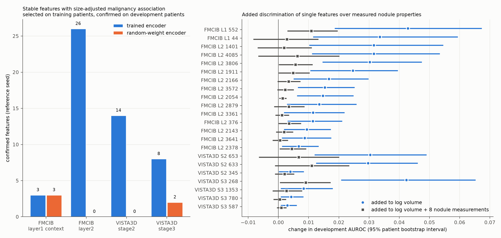

# Feature candidates in the interpretation dictionaries

Which stable SAE features of the interpretation dictionaries carry malignancy information that nodule size does not explain, and does a same-architecture random-weight encoder produce the same features?

## Procedure

Run `20261015_feature_candidates` uses the reference seed (2025) of each interpretation dictionary and of its random-weight control (campaign `20261014_sae_interpretation`). Each patient contributes one nodule record. The case value of a feature is its maximum over valid positions inside the nodule or within 4 mm of its surface.

- **Selection on training patients (1,264).** A feature is selected when it is stable (decoder cosine ≥ 0.7 in at least 6 of 7 other seeds, active on development) and its Spearman partial correlation with malignancy, controlling log nodule volume, exceeds the 95th percentile of absolute values of the random-weight reference dictionary at the same site.
- **Confirmation on development patients (422).** The partial correlation has the same sign and a Benjamini-Hochberg q below 0.05 within the selected set of that site and encoder.
- **Additional checks on confirmed features:**
  - partial correlation controlling log volume plus sphericity, HU mean, HU standard deviation, solid fraction and mean HU of the 0–5 mm ring;
  - the same direction in matched features of the other seeds;
  - added development AUROC of a logistic model fitted on training patients, with a 95% patient bootstrap interval;
  - rank correlations among candidates.

The independent test partition is unused.

## Results

| Site | Stable features (trained / random) | Selected | Confirmed, trained encoder | Confirmed, random-weight encoder |
|---|---:|---:|---:|---:|
| FMCIB layer1 complete context | 84 / 68 | 4 / 4 | 3 | 3 |
| FMCIB layer2 | 645 / 151 | 35 / 4 | 26 (18 correlated groups) | 0 |
| VISTA3D stage2 | 180 / 126 | 29 / 4 | 14 | 0 |
| VISTA3D stage3 | 325 / 90 | 14 / 5 | 8 | 2 |

Every confirmed feature also keeps its direction after the five shape and density measurements are added as covariates. At FMCIB layer2, VISTA3D stage2 and VISTA3D stage3 the trained encoder yields more confirmed features than its random-weight control; at FMCIB layer1 complete context both encoders yield three.

Log volume alone gives a development AUROC of 0.808. Twenty-two confirmed features have a bootstrap interval of added AUROC above zero. The largest gains:

| Feature | Added AUROC over log volume |
|---|---:|
| FMCIB layer1 552 | +0.043 [0.019, 0.067] |
| VISTA3D stage3 268 | +0.042 [0.021, 0.065] |
| FMCIB layer1 44 | +0.034 |
| FMCIB layer2 1401 | +0.032 |
| FMCIB layer2 4085 | +0.032 |
| FMCIB layer2 3806 | +0.030 |
| VISTA3D stage2 653 | +0.030 |
| VISTA3D stage2 633 | +0.030 |

A model with log volume and eight nodule measurements reaches 0.852. The size-adjusted mean HU of the 5–10 mm ring is itself associated with malignancy (partial correlation −0.15 on training and −0.14 on development patients). Over this model, the partial correlations of all 22 features remain significant on development patients. Their added AUROC is at most +0.011, and only FMCIB layer1 552 has an interval clearly above zero ([0.003, 0.020]).

Features from both encoders agree at the patient level: FMCIB layer1 44 and 552, FMCIB layer2 4085, 1401 and 3806, VISTA3D stage2 653 and VISTA3D stage3 268 have rank correlations of 0.61–0.82 with one another on training patients. All of them:
- respond mainly inside the nodule or at its margin;
- after size adjustment, rise with malignancy and fall as the 5–10 mm ring around the nodule becomes denser.

VISTA3D stage2 633 is the only confirmed feature that is higher in benign nodules. It responds mainly 4–10 mm outside the nodule surface and increases with ring density. It is nearly uncorrelated with the other candidates.

These are associations in one reference seed with descriptive image review; feature identities in clinical terms and their causal role in the classifier are untested.

## Files

| File | Content |
|---|---|
| [site_summary.csv](site_summary.csv) | counts per site and encoder, random-weight threshold |
| [confirmed_trained.csv](confirmed_trained.csv) | confirmed trained-encoder features with all statistics |
| [confirmed_random.csv](confirmed_random.csv) | confirmed random-weight features |
| [all_references.csv](all_references.csv) | partial correlation and added AUROC over log volume plus eight nodule measurements |
| [candidate_correlation_discovery.csv](candidate_correlation_discovery.csv) | rank correlations among those candidates on training patients |
| [provenance.json](provenance.json) | run identity, settings and code hashes |

Code: [sae_interp_candidates.py](../../src/sclvmi/sae_interp_candidates.py) (`python -m sclvmi.sae_interp_candidates`) and [sae_interp_followup.py](../../src/sclvmi/sae_interp_followup.py) (`python -m sclvmi.sae_interp_followup --export <directory>`); settings in the `candidates` section of [sae_interpretation.json](../../configs/sae_interpretation.json). Per-patient values remain in private storage.
