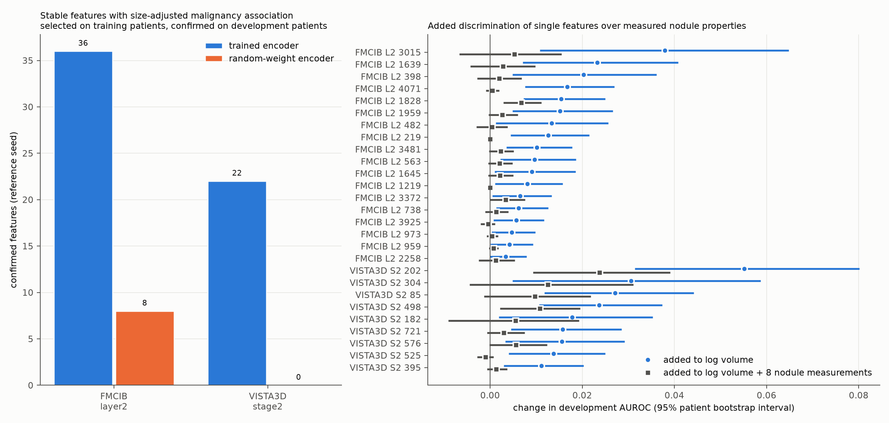

# Feature candidates in the nodule-interpretation dictionaries

Which stable features of the [nodule-region dictionaries](../20261015_sae_nodule_coverage/README.md) carry malignancy information that nodule size does not explain, and does the same-architecture random-weight encoder produce the same features? Sites: FMCIB layer2 (expansion 4, k8, `nodule75`) and VISTA3D stage2 (expansion 4, k16, `nodule16x`).

## Procedure

Run `20261015_feature_candidates_nodule` follows the procedure of [the earlier candidate run](../20261015_feature_candidates/README.md) on the reference seed (2025) of each dictionary and of its random-weight control (campaign `20261014_sae_interpretation`). Each patient contributes one nodule record; the case value of a feature is its maximum over valid positions inside the nodule or within 4 mm of its surface.

- **Selection on training patients (1,264):** stable features (decoder cosine ≥ 0.7 in at least 6 of 7 other seeds, active on development) whose Spearman partial correlation with malignancy, controlling log nodule volume, exceeds the 95th percentile of absolute values of the random-weight reference dictionary at the same site.
- **Confirmation on development patients (422):** same sign and Benjamini-Hochberg q below 0.05 within the selected set of that site and encoder.
- **Additional checks:** partial correlation adding sphericity, HU mean, HU standard deviation, solid fraction and 0–5 mm ring HU; direction in matched features of the other seeds; added development AUROC of a logistic model fitted on training patients (95% patient bootstrap interval); the same over log volume plus eight nodule measurements.

The independent test partition is unused.

## Results

| Site | Stable features (trained / random) | Selected (trained / random) | Confirmed, trained encoder | Confirmed, random-weight encoder |
|---|---:|---:|---:|---:|
| FMCIB layer2 | 1,442 / 698 | 62 / 45 | 36 (30 correlated groups) | 8 |
| VISTA3D stage2 | 207 / 54 | 33 / 3 | 22 (14 groups) | 0 |

All confirmed features keep their direction after the five shape and density measurements are added (p < 0.05). One VISTA3D stage2 feature (498) is higher in benign nodules; all others are higher in malignant nodules.

The eight confirmed random-weight features at FMCIB layer2 are nodule-enriched and correlate with size (Spearman 0.37–0.68) but add at most 0.007 development AUROC over log volume (lower interval bounds −0.002 to 0.001). A random network still responds to nodule intensity, so at this site a size-adjusted association alone does not separate trained from random features; added discrimination does.

Log volume alone gives a development AUROC of 0.808. Twenty-seven confirmed trained-encoder features have an added-AUROC interval above zero (18 at layer2, 9 at stage2). The largest gains:

| Feature | Added AUROC over log volume | Over log volume + 8 measurements (0.852) |
|---|---:|---:|
| VISTA3D stage2 202 | +0.055 [0.031, 0.080] | +0.024 [0.009, 0.039] |
| FMCIB layer2 3015 | +0.038 [0.011, 0.065] | +0.005 [−0.007, 0.015] |
| VISTA3D stage2 304 | +0.031 [0.005, 0.059] | +0.013 [−0.004, 0.031] |
| VISTA3D stage2 85 | +0.027 [0.012, 0.044] | +0.010 [−0.001, 0.022] |
| VISTA3D stage2 498 | +0.024 [0.011, 0.037] | +0.011 [0.002, 0.020] |
| FMCIB layer2 1639 | +0.023 [0.007, 0.041] | +0.003 |
| FMCIB layer2 398 | +0.020 [0.005, 0.036] | +0.002 |

Over volume plus eight measurements, the partial correlations of all 27 features remain significant on development patients; three have added-AUROC intervals above zero: VISTA3D stage2 202, VISTA3D stage2 498 and FMCIB layer2 1828 (+0.007 [0.003, 0.011]).

- **VISTA3D stage2 202** responds most inside the nodule and at its margin, rises with malignancy after size adjustment, and falls as the 5–10 mm ring around the nodule becomes denser. Its patient ranks correlate with VISTA3D stage2 85 (0.80) and FMCIB layer2 3015 (0.71), 1639 (0.64) and 398 (0.60) on training patients, so the two encoders share this signal.
- **VISTA3D stage2 498** responds mainly 4–10 mm outside the nodule surface, is higher in benign nodules, rises with ring density, and is nearly uncorrelated with the other candidates (|ρ| ≤ 0.15).

These are associations in one reference seed; feature identities in clinical terms and their causal role in the classifier are untested.

## Files

| File | Content |
|---|---|
| [site_summary.csv](site_summary.csv) | counts per site and encoder, random-weight threshold |
| [confirmed_trained.csv](confirmed_trained.csv) | confirmed trained-encoder features with all statistics |
| [confirmed_random.csv](confirmed_random.csv) | confirmed random-weight features |
| [all_references.csv](all_references.csv) | partial correlation and added AUROC over log volume plus eight nodule measurements |
| [candidate_correlation_discovery.csv](candidate_correlation_discovery.csv) | rank correlations among those candidates on training patients |
| [provenance.json](provenance.json) | run identity, settings and code hashes |

Code: [sae_interp_candidates.py](../../src/sclvmi/sae_interp_candidates.py) (`python -m sclvmi.sae_interp_candidates --sites fmcib:layer2,vista:stage2`) and [sae_interp_followup.py](../../src/sclvmi/sae_interp_followup.py) (`python -m sclvmi.sae_interp_followup --export <directory>`); settings in the `candidates` section of [sae_interpretation.json](../../configs/sae_interpretation.json). Per-patient values remain in private storage.
