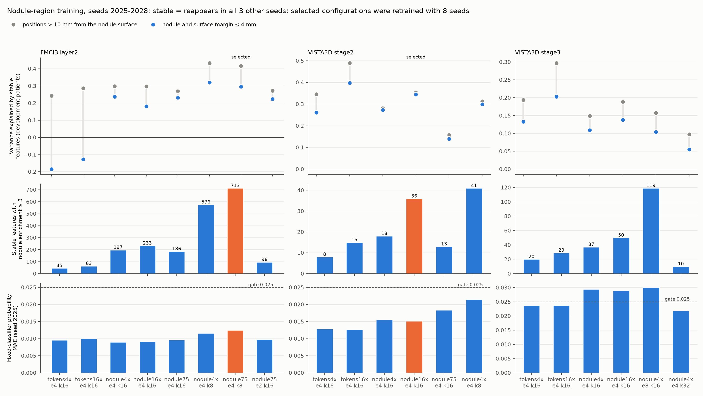

# Nodule-region training of the interpretation dictionaries

Campaign `20261014_sae_interpretation`. Development patients only (one record each, 422 patients); the independent test set is unused.

## Question

With training tokens sampled uniformly from each training record, positions inside the nodule or within 4 mm of its surface make up 2.1% of the FMCIB layer2 tokens and about 1% at VISTA3D stage2 and stage3. Features that reappear across seeds (stable features) then describe the background far better than the nodule: at FMCIB layer2, stable features alone explain −0.185 of the variance at nodule positions and 0.242 beyond 10 mm. The interpretation that follows centres on the nodule, so this step asks which training makes the nodule region covered by reproducible features while keeping the fixed classifier's output.

## Method

- **Nodule pool**: positions of the 3,729 training records (1,264 patients) within 10 mm of the target nodule surface, in three bands (inside, 0–4 mm, 4–10 mm). Training batches (2,048 tokens) draw a fixed fraction from the pool, split evenly over the bands, and the rest from the uniform training matrix ([`sae_nodule_pool.py`](../../src/sclvmi/sae_nodule_pool.py), [`sae_campaign_train.py`](../../src/sclvmi/sae_campaign_train.py)).
- **Variants**: `tokens4x` (uniform, 48,000 steps; earlier dictionaries), `tokens16x` (uniform, 192,000), `nodule4x` (pool fraction 0.5, 48,000), `nodule16x` (0.5, 192,000), `nodule75` (0.75, 48,000), plus k8, k32 and expansion 2 or 8 where noted.
- **Coverage** ([`sae_interp_coverage.py`](../../src/sclvmi/sae_interp_coverage.py)): reconstruction with stable features only, variance explained per region by signed distance to the nodule surface; patient bootstrap interval of the nodule-minus-far difference (2,000 resamples); nodule enrichment = activation frequency in the nodule region divided by the frequency over all positions.
- **Classifier check**: the deployed representation is fully replaced by the reconstruction; probability MAE ≤ 0.025, AUROC drop ≤ 0.01, AP drop ≤ 0.02.
- **Sufficiency standard** for nodule interpretation, evaluated on 8-seed dictionaries: all seeds pass the classifier check; stable features with nodule enrichment ≥ 3 clearly exceed both the `tokens4x` dictionary and the random-weight encoder control; stable-feature explained variance at the nodule exceeds `tokens4x`. Random-weight encoders reach high explained variance with few features, so explained variance is compared only against `tokens4x`.

## Comparison (seeds 2025–2028)

Per-configuration values: [comparison.csv](comparison.csv) (stable rule: reappears in all 3 other seeds).

Nodule-pool training raises nodule coverage at FMCIB layer2 (from −0.185 to 0.18–0.32) and closes most of the nodule-to-background gap at VISTA3D stage2 (from −0.084 to between −0.009 and −0.018). At FMCIB layer2, k8 gives the most stable features in every region and the most nodule-specific stable features; background coverage rises faster, so the gap widens. VISTA3D stage3 exceeds the classifier gate with nodule-pool training at k16 and expansion 8; at k32 it passes but keeps 76 stable features.

## Selected dictionaries (8 seeds)

Stable rule: reappears in at least 6 of the 7 other seeds. Values: [production.csv](production.csv).

| Site | Configuration | Stable features per seed (random control, seed 2025) | Probability MAE / recovered AUROC | Stable-feature variance explained: nodule / 4–10 mm / > 10 mm | Nodule − far [95% interval] | Stable features with nodule enrichment ≥ 3: selected / tokens4x / random control |
|---|---|---|---|---|---|---|
| FMCIB layer2 | e4 k8 `nodule75`, 4,096 features | 1,425–1,481 (698) | 0.0118–0.0129 / 0.883–0.887 | 0.310 / 0.374 / 0.413 (tokens4x −0.176 / 0.079 / 0.238) | −0.103 [−0.151, −0.054] | 733 / 49 / 341 |
| VISTA3D stage2 | e4 k16 `nodule16x`, 768 features | 205–223 (54) | 0.0151–0.0158 / 0.879–0.887 | 0.360 / 0.343 / 0.355 (tokens4x 0.265 / 0.316 / 0.365) | +0.005 [−0.014, 0.027] | 36 / 8 / 1 |

Both sites meet the standard and serve nodule interpretation. FMCIB layer1 (complete context) and VISTA3D stage3 keep the `tokens4x` dictionaries of [the interpretation materials](../20261014_sae_interpretation_materials/README.md) and are not used for nodule interpretation: layer1 stable features are close to the random-weight control, and no stage3 configuration both passed the classifier check and kept nodule coverage.

Provenance, including configuration and source hashes: [provenance.json](provenance.json). Exporter: [`export_sae_nodule_coverage.py`](../../scripts/pipeline/export_sae_nodule_coverage.py).
