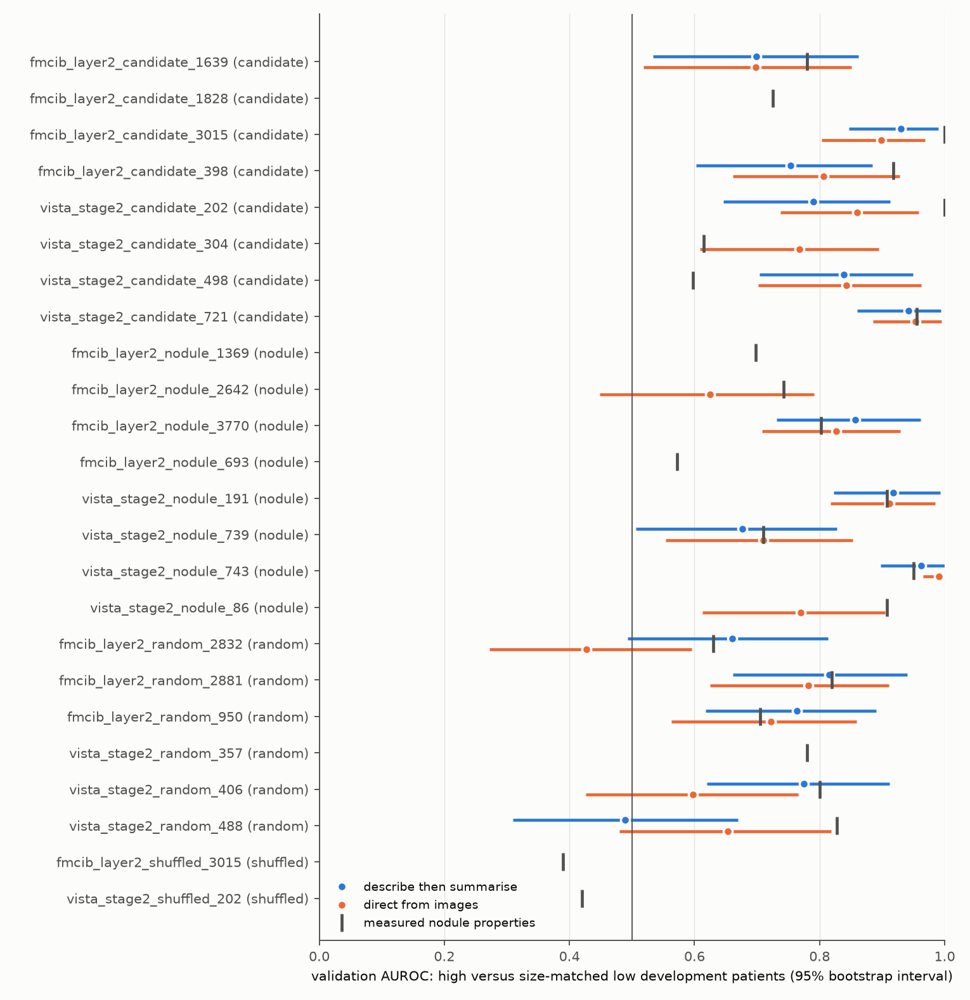
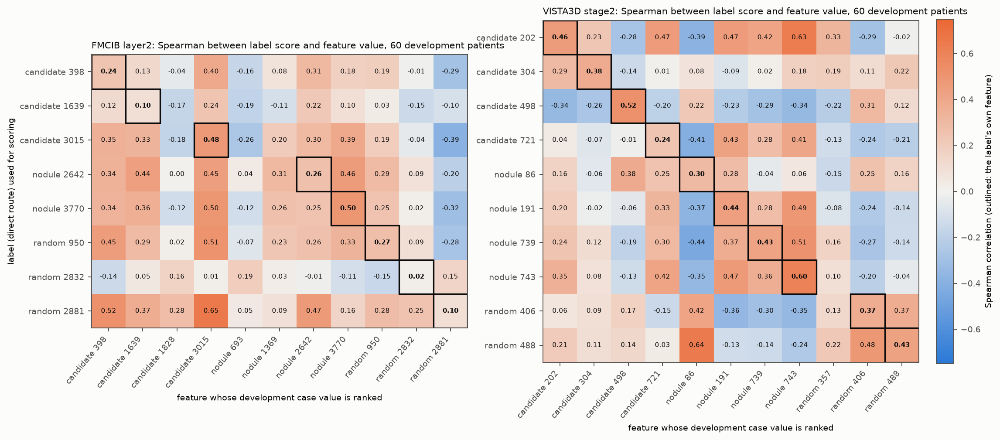

# Automatic interpretation with matched contrasts

In the [pilot](../20261015_autointerp_pilot/README.md), most labels named one coarse contrast. High-activation nodules were free nodules surrounded by aerated lung; their size-matched low-activation partners were often attached to pleura or soft tissue (0–5 mm ring HU: high minus low −131 HU on average). This run asks whether labels become specific to individual features when that contrast is removed. Run `20261016_autointerp_matched`, model `gpt-6.1-sol`. The independent test set is unused.

## Design

- **Same as the pilot:** the 24 features, rendering, two routes, blind validation, measured-property baseline and 60-patient specificity panels.
- **Matching:** each low example is the low-value patient nearest to its high example in standardized log nodule volume (weight 3), 0–5 mm ring HU mean and solid fraction (weight 1 each). Prompts state that the groups are matched on these.

| Mean difference, high minus low | Pilot | This run |
|---|---|---|
| Log volume | +0.31 (absolute 0.35) | +0.37 (absolute 0.49) |
| 0–5 mm ring HU | −131 (absolute 226) | −48 (absolute 87) |
| Solid fraction | +0.01 (absolute 0.28) | +0.02 (absolute 0.10) |

## Results

| | Pilot | This run |
|---|---|---|
| Median measured-property AUROC (candidates / nodule-enriched / random-weight) | 0.95 / 0.91 / 0.80 | 0.85 / 0.77 / 0.79 |
| Non-shuffled feature–route pairs answered "no clear pattern" | 4 of 44 | 11 of 44 |
| Median label AUROC, trained / random-weight features | 0.86 / 0.79 | 0.84 / 0.69 |
| Labels above the measured-property baseline, trained / random-weight | 9 of 29 / 6 of 11 | 10 of 23 / 3 of 10 |
| Labels whose own feature ranks first on the specificity panel | 3 of 22 | 5 of 18 |
| Mean Spearman with own feature / other features | 0.37 / 0.15 | 0.34 / 0.09 |

- **Shuffled controls:** again yield no label in either route.
- **Effect of the harder contrast:**
  - more features yield no label;
  - random-weight labels lose more than trained-encoder labels;
  - the gap between own-feature and other-feature correlation widens.
- **Feature-specific labels:**
  - VISTA3D stage2 498, "lung-base context near the diaphragm": AUROC 0.84 [0.70, 0.96] against a measured-property baseline of 0.60; own-feature ρ 0.52, negative with most others. The same label appeared in the pilot.
  - VISTA3D stage2 304, "compact nodule with a fuzzy, tufted edge": AUROC 0.77 [0.61, 0.90], baseline 0.62; own-feature ρ 0.38 (pilot 0.17).
  - VISTA3D stage2 743, "discrete rounded nodule": AUROC 0.99, ρ 0.60.
  - FMCIB layer2 3770, "nodule in relatively open lung": AUROC 0.83–0.86, baseline 0.80, ρ 0.50.
  - FMCIB layer2 3015: own feature ranks first.
- **Still shared:** labels describing compact free nodules (VISTA3D stage2 191, 739, 743, 721 and FMCIB layer2 3015, 3770, random 950) still rank each other's features similarly, so this group is one visual concept rather than separate ones.

## Files

Same layout as the pilot: [validation.csv](validation.csv), [summary_by_role.csv](summary_by_role.csv), [specificity.csv](specificity.csv), [provenance.json](provenance.json). Configuration [sae_autointerp_matched.json](../../configs/sae_autointerp_matched.json); code as in the pilot. Rendered patient images, per-example descriptions and per-patient scores remain in private storage.
