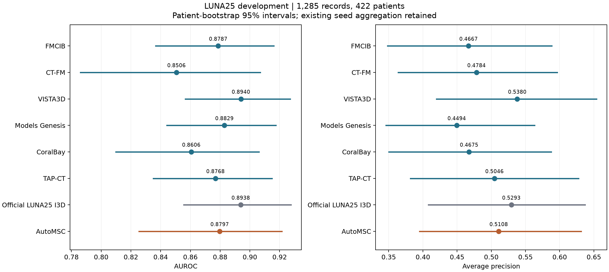

# AutoMSC and existing LUNA25 development pipelines

[Comparison figure](comparison.png) · [Metrics](comparison.csv) · [Paired AUROC differences](paired_differences.csv)

AutoMSC reaches AUROC 0.8797 [0.8254, 0.9216] and AP 0.5108. Its paired AUROC differences are −0.0143 [−0.0661, +0.0312] against VISTA3D and −0.0142 [−0.0560, +0.0263] against official I3D. Both intervals include zero. The [twelve-pipeline comparison](../20261018_all_pipeline_development/README.md) adds nnFoundation and FlexiCT.

Training uses 3,729 records from 1,264 patients; development uses the same 1,285 records from 422 patients for all 8 entries. The independent test partition remains reserved. AutoMSC uses classification and segmentation supervision. The other entries use classification supervision. The six frozen encoder configurations and official I3D predictions are fixed to the existing September 26 results.

AutoMSC continues the official 1,000-epoch recipe from the saved epoch-441 state on Mayo; the final checkpoint supplies the development predictions. The table preserves the existing mean of three neural-head seeds and single-fit linear results; AutoMSC and I3D each use one seed. Intervals use 2,000 paired patient bootstrap draws, retaining all records per sampled patient. Configuration selection used development data.
