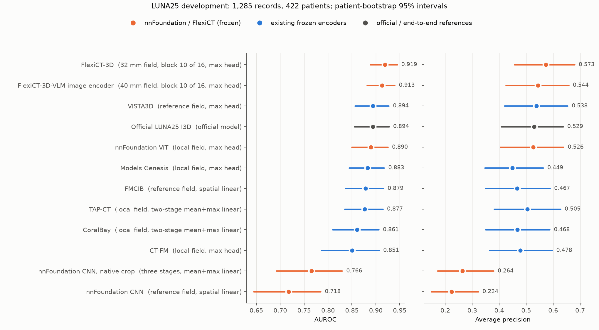

# nnFoundation and FlexiCT as frozen LUNA25 encoders

Suite `20261017_encoder_pipeline` evaluates nnFoundation (CNN and ViT; arXiv:2609.26924) and FlexiCT (the 3D self-supervised teacher and the image encoder of its 3D vision-language model; arXiv:2605.21906) as frozen encoders under the same procedure as the six existing encoders, and compares them with those encoders and the locally trained official LUNA25 I3D.

## Procedure

- **Data:** training uses 3,729 records from 1,264 patients and development uses 1,285 records from 422 patients; the independent test partition is reserved.
- **Inputs:** nodule-centred physical crops at the provider crop centre.
  - nnFoundation: z-score without clipping; reference field 64 mm, local field 32 mm.
  - FlexiCT: HU clipped to [-1000, 1000] then z-scored; reference field 72 mm at the 1.5 mm pretraining spacing, local field 50 mm.
  - nnFoundation CNN, native crop: the provider crop at native spacing without resampling (128 x 128 x 64 voxels), as recommended for nnFoundation. Its second view uses an earlier encoder stage of the same input in place of a smaller field.
- **Encoders:** loaded strictly. nnFoundation is built from the checkpoint plan as in the official classification code, FlexiCT with its official loader; outputs were checked against the official forward passes.
- **Classifiers:**
  - Reference field: embedding linear, spatial linear, embedding MLP, and mean, max and attention heads.
  - Local field: four mean+max linear descriptors and a max head.
  - Neural heads choose the learning rate on seed 2025 and repeat it with seeds 2026 and 2027.
- **FlexiCT layer and field comparison:** a max head on the patch tokens of blocks 4–16 (of 16) with 32, 40, 50 and 64 mm fields (48^3 tensors), plus the two fields of the standard procedure combined. Each candidate uses seed 2025 at two learning rates; the best is repeated with seeds 2026 and 2027 and replaces the standard selection when its three-seed mean is higher. See [main grid](layers_fields_main.png) and [extension](layers_fields_extension.png).
- **Selection and comparison:** selection by development AUROC with a log-loss tie break. Intervals use 2,000 paired patient-bootstrap draws. Configuration selection used development data.

## Results

| Encoder | Pipeline | Seeds | AUROC [95% interval] | AP |
|---|---|---:|---|---:|
| FlexiCT-3D | 32 mm field, block 10 of 16, max head | 3 | 0.9191 [0.888, 0.945] | 0.5727 |
| FlexiCT-3D-VLM image encoder | 40 mm field, block 10 of 16, max head | 3 | 0.9129 [0.882, 0.940] | 0.5437 |
| VISTA3D | reference field, max head | 3 | 0.8940 [0.857, 0.927] | 0.5380 |
| Official LUNA25 I3D | official model | 1 | 0.8938 [0.856, 0.928] | 0.5293 |
| nnFoundation ViT | local field, max head | 3 | 0.8897 [0.850, 0.925] | 0.5263 |
| Models Genesis | local field, max head | 3 | 0.8829 [0.844, 0.918] | 0.4494 |
| FMCIB | reference field, spatial linear | 1 | 0.8787 [0.837, 0.916] | 0.4667 |
| TAP-CT | local field, two-stage mean+max linear | 1 | 0.8768 [0.835, 0.915] | 0.5046 |
| CoralBay | local field, two-stage mean+max linear | 1 | 0.8606 [0.810, 0.906] | 0.4675 |
| CT-FM | local field, max head | 3 | 0.8506 [0.786, 0.907] | 0.4784 |
| nnFoundation CNN, native crop | three stages, mean+max linear | 1 | 0.7656 [0.692, 0.830] | 0.2636 |
| nnFoundation CNN | reference field, spatial linear | 1 | 0.7179 [0.645, 0.785] | 0.2236 |

| Comparison | AUROC difference [95% interval] |
|---|---|
| nnFoundation CNN minus VISTA3D | -0.1761 [-0.233, -0.124] |
| nnFoundation CNN minus Official LUNA25 I3D | -0.1759 [-0.247, -0.112] |
| nnFoundation CNN, native crop minus VISTA3D | -0.1284 [-0.185, -0.081] |
| nnFoundation CNN, native crop minus Official LUNA25 I3D | -0.1282 [-0.199, -0.069] |
| nnFoundation ViT minus VISTA3D | -0.0043 [-0.032, +0.024] |
| nnFoundation ViT minus Official LUNA25 I3D | -0.0042 [-0.029, +0.022] |
| FlexiCT-3D minus VISTA3D | +0.0252 [+0.002, +0.050] |
| FlexiCT-3D minus Official LUNA25 I3D | +0.0253 [+0.003, +0.048] |
| FlexiCT-3D-VLM image encoder minus VISTA3D | +0.0189 [-0.001, +0.040] |
| FlexiCT-3D-VLM image encoder minus Official LUNA25 I3D | +0.0191 [-0.004, +0.043] |

- **FlexiCT:**
  - Under the standard procedure both FlexiCT encoders matched VISTA3D (50 mm local field, final block: 0.8966 and 0.8945).
  - Earlier blocks and smaller fields work better. Block 10 of 16 is the peak for both encoders at 32 and 40 mm; blocks 4 and 6 and fields of 50–64 mm are lower.
  - FlexiCT-3D with a 32 mm field and the vision-language image encoder with a 40 mm field reach three-seed means of 0.919 and 0.913.
  - The paired differences against VISTA3D are listed above. The development patients that give these intervals also chose among 21 field and layer candidates per encoder (42 fits), so the advantages are optimistic.
- **nnFoundation ViT:** matches VISTA3D and the official I3D.
- **nnFoundation CNN:** its frozen features stay far lower with every input and head tried, including the native-resolution crop.
  - The nnFoundation paper reports that the masked-autoencoding CNN can underperform when encoder features are not adapted to the task; its classification experiments use full fine-tuning.
  - With 64^3 inputs the last ResEncL stage has 2^3 positions for its instance normalization.

## Files

- `comparison.csv`: selected pipelines with patient-bootstrap intervals.
- `paired_differences.csv`: paired AUROC differences against VISTA3D and the official I3D.
- `candidates.csv`: every candidate pipeline of the new encoders, including the FlexiCT field and layer candidates (`view` names the suite and candidate).
- `layers_fields_main.png`, `layers_fields_extension.png`: seed-2025 development AUROC of the FlexiCT field and layer candidates.
- `provenance.json`: prediction hashes and settings.
