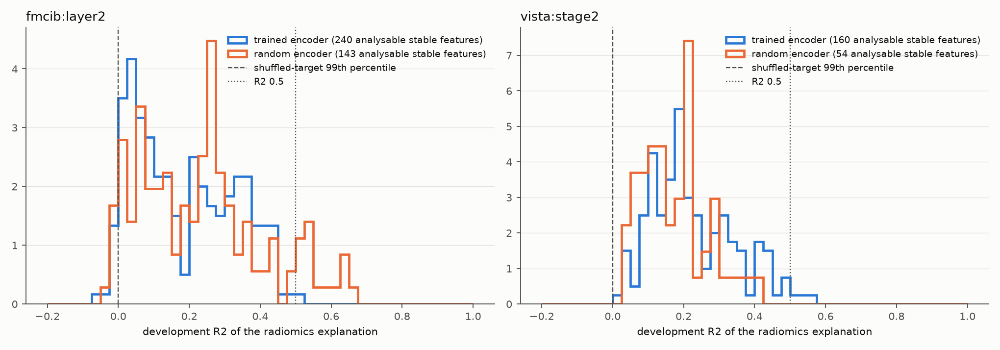
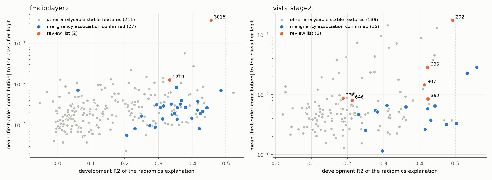

# Nodule SAE features compared with radiomics image features

Run `20261017_sae_radiomics` asks which stable features of the [nodule-interpretation dictionaries](../20261015_sae_nodule_coverage/README.md) (seed 2025; FMCIB layer2 `nodule75`, VISTA3D stage2 `nodule16x`) follow computable image properties of the nodule and its surroundings, which of them change the fixed malignancy classifier, and which combine a confirmed malignancy association, a classifier effect and an incomplete radiomics description. That last group is listed for human review.

## Procedure

- **Patients:** one nodule record per patient; 1,264 training patients for selection and fitting, 422 development patients for evaluation. The independent test partition is unused.
- **Radiomics:** PyRadiomics on CT resampled to 1 mm, bin width 25 HU.
  - Nodule: shape, first-order and texture features.
  - Rings 0–4 mm and 4–10 mm outside the surface: first-order and texture features.
  - Position and contact: distance and contact fraction to tissue outside the aerated, closed and hole-filled lung (chest wall, mediastinum, diaphragm); the same for large soft-tissue structures (mostly attached vessels); soft-tissue, air and outside-lung fractions of both rings.
  - 306 features, grouped into 98 groups at training |Spearman| >= 0.9.
- **Targets:** each feature's mean activation within 4 mm of the nodule surface or 4–10 mm outside it, whichever is larger on training patients. The deployed grids are about 7 mm (FMCIB) and 6 mm (VISTA3D) apart, so the nodule interior holds no grid position for many patients.
- **Explanation:** normal scores on training patients, stepwise selection of up to five group representatives (minimum training R2 gain 0.01), R2 on development patients. The shuffled-target control's 99th percentile is about zero.
- **Categories:**
  - Explained: R2 >= 0.5, above the control, and cross-seed agreement >= 0.8.
  - Partly explained: above the control otherwise.
  - Not explained: at or below the control.
  - Features active in fewer than 30 development patients near the nodule are listed separately.
- **Classifier effect:** first-order contribution of each feature to the fixed classifier's logit on development patients (activation times decoder direction dot logit gradient). The 50 largest are removed exactly and the logit recomputed.
- **Review list:** stable, malignancy association beyond nodule volume confirmed in [the candidate run](../20261015_feature_candidates_nodule/README.md), among the 50 largest classifier contributions, and not explained by radiomics.

## Results

| Site | Encoder | Stable | Explained | Partly | Not explained | Active in < 30 patients | Median R2 (analysable) |
|---|---|---:|---:|---:|---:|---:|---:|
| fmcib:layer2 | random | 698 | 16 | 120 | 7 | 555 | 0.233 |
| fmcib:layer2 | trained | 1,442 | 1 | 229 | 10 | 1,202 | 0.160 |
| vista:stage2 | random | 54 | 0 | 54 | 0 | 0 | 0.167 |
| vista:stage2 | trained | 207 | 3 | 157 | 0 | 47 | 0.198 |

- **Description by radiomics:** most analysable features are partly described, with typical development R2 of 0.1–0.3. Size and surrounding density terms are selected most often.
- **Random-weight control:** random-weight features reach similar R2 (FMCIB median 0.233 against 0.160 for trained features; VISTA3D 0.167 against 0.198). A low R2 therefore does not by itself indicate a concept beyond radiomics, because grid spacing, regional averaging and sparse activation limit the attainable R2.
- **Cross-seed agreement:** nearly every feature exceeds 0.8, so this criterion separates little.
- **Classifier effect:** first-order and exact-removal changes correlate at 0.954 (fmcib:layer2) and 0.982 (vista:stage2).
  - The classifier effect is concentrated in very few features: FMCIB layer2 3015 (mean logit change on removal −0.40; the next feature −0.06) and VISTA3D stage2 202 (−0.18).
  - Both have confirmed malignancy associations. After nodule volume is controlled, both correlate most with surrounding aerated lung, i.e. lower soft-tissue and outside-lung fractions (Spearman −0.70 and about −0.45).
  - Radiomics describes about half of their variance (R2 0.46 and 0.49).

## Files

- `categories.csv`: category counts per site and encoder.
- `explanations.csv`: every stable feature with its selected radiomics terms and the terms most correlated before and after controlling nodule volume.
- `trained_features.csv`: the same for trained-encoder features, plus classifier contributions and malignancy confirmation.
- `review_list.csv`: the 8 features for human review.
- `radiomics_groups.csv`: the radiomics feature groups.
- `provenance.json`: run settings and source hashes.
