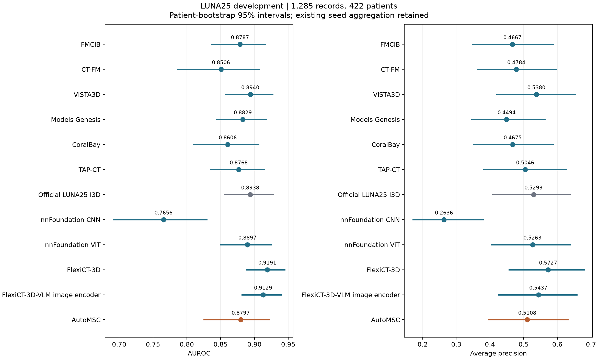

# Twelve LUNA25 development pipelines

[Comparison figure](comparison.png) · [Metrics](comparison.csv) · [Paired AUROC differences](paired_differences.csv)

AutoMSC reaches AUROC 0.8797 [0.8254, 0.9216] and AP 0.5108. Its paired AUROC difference against VISTA3D is −0.0143 [−0.0661, +0.0312]. FlexiCT-3D has the highest development AUROC, 0.9191; the AutoMSC-minus-FlexiCT-3D difference is −0.0395 [−0.0802, −0.0053]. These intervals describe fixed selected configurations and do not account for development-based configuration selection.

Training uses 3,729 records from 1,264 patients; development uses the same 1,285 records from 422 patients for all 12 entries. The independent test partition remains reserved. AutoMSC uses classification and segmentation supervision. The other entries use classification supervision. The six frozen encoder configurations and official I3D predictions are fixed to the existing September 26 results.

AutoMSC continues the official 1,000-epoch recipe from the saved epoch-441 state on Mayo; the final checkpoint supplies the development predictions. The table preserves the existing mean of three neural-head seeds and single-fit linear results; AutoMSC and I3D each use one seed. Intervals use 2,000 paired patient bootstrap draws, retaining all records per sampled patient. Configuration selection used development data.

The four additional encoder configurations are fixed to the saved October 17 selection: nnFoundation CNN uses the native crop, nnFoundation ViT uses the 32 mm field, and FlexiCT uses block 10 with 32 mm (3D) or 40 mm (VLM image encoder) fields. The FlexiCT configurations involved additional development-based field and layer selection. See the [encoder comparison](../20261017_encoder_pipeline/README.md) for the selection procedure.
