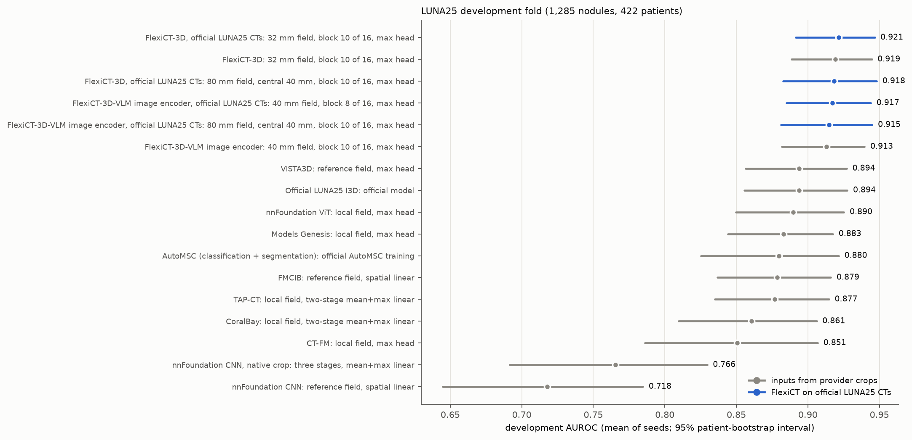

# FlexiCT on the official LUNA25 whole CTs

Suite `20261019_flexict_luna25` rebuilds the FlexiCT pipelines from the official LUNA25 whole CTs instead of the FLARE-AutoMSC provider crops. It also tests whether context beyond the 128 × 128 × 64 crop, including FlexiCT's official whole-CT input form, improves nodule malignancy classification.

## Data

- **Images:** official LUNA25 whole CTs (Zenodo 10.5281/zenodo.14223624 v1.0.0) and the official annotation table (Zenodo 10.5281/zenodo.14673658).
- **Nodules and split:** the 6,132 nodules kept by the FLARE-AutoMSC cleaning and its patient-grouped folds, as in all earlier pipelines.
  - Training: 3,729 nodules.
  - Development: 1,285 nodules from 422 patients.
  - The independent test fold (1,118 nodules) is reserved. Its inputs were prepared but not encoded.
- **Provider crops checked against the official scans:**
  - Every FLARE crop is a 128 × 128 × 64 native-voxel block of its official scan, centred on SimpleITK `TransformPhysicalPointToIndex` of the official coordinate, as in `luna25-baseline-public` `preprocessing/extract_nodules.py`.
  - 6,130 crops are voxel-identical to the scan.
  - Two benign crops are corrupted in the FLARE files: one in the training fold and one in the test fold. Here they come from the official scans.
  - No development crop is affected.

## Views

All views use the frozen FlexiCT-3D teacher or the image encoder of FlexiCT-3D-VLM, blocks 6–16 of 16, and a max head over patch tokens.

| View | Input | Readout |
|---|---|---|
| 32 mm field | 48³ at 0.67 mm, rebuilt from the provider-crop region | all 216 tokens |
| 40 mm field | 48³ at 0.83 mm, rebuilt from the provider-crop region | all 216 tokens |
| 80 mm field, central 40 mm | 96³ at 0.83 mm from the whole CT | central 6³ tokens (the 40 mm region) |
| whole CT 1.5 mm | official image-text preprocessing at 1.5 mm, 160³ window | the 4³ tokens nearest the nodule |
| whole CT 2.0 mm | official CT-RATE evaluation form: 2.0 mm, MONAI 160³ centre crop | the 3³ tokens nearest the nodule |

- **Field inputs:** the 32 and 40 mm fields equal the earlier pipelines' inputs exactly, except for the corrected crop.
- **Whole-CT preprocessing:** SimpleITK linear resampling, HU clipped to [−1000, 1000], z-score over the resampled volume, then padding with its minimum to at least 160 voxels per axis.
- **Whole-CT windows:**
  - Each nodule's class token and mean patch token come from the official centre window.
  - Readout tokens come from that window unless the nodule lies within 24 mm of its border. In that case a window moved only as far as needed is encoded: 3,139 of 6,132 nodules at 1.5 mm and 348 at 2.0 mm.
- **Fusion candidate:** the better provider-crop field, the better whole-CT view and that view's class token in one bag.
- **Selection:**
  - Each candidate is fit with seed 2025 at two learning rates.
  - The best candidate overall, the best provider-crop candidate and the best context candidate are repeated with seeds 2026 and 2027.
  - Configurations were selected on the development fold.

## Results

Development AUROC, mean of three seeds, with 95% patient-bootstrap intervals (2,000 paired draws):

| Pipeline | AUROC | AP |
|---|---|---:|
| FlexiCT-3D, official CTs, 32 mm field, block 10 | 0.9215 [0.891, 0.947] | 0.585 |
| FlexiCT-3D, provider crops, 32 mm field, block 10 (earlier selection) | 0.9191 [0.888, 0.945] | 0.573 |
| FlexiCT-3D, official CTs, 80 mm field, central 40 mm, block 10 | 0.9184 [0.883, 0.948] | 0.565 |
| FlexiCT-3D-VLM image encoder, official CTs, 40 mm field, block 8 | 0.9170 [0.885, 0.944] | 0.577 |
| FlexiCT-3D-VLM image encoder, official CTs, 80 mm field, central 40 mm, block 10 | 0.9147 [0.881, 0.945] | 0.565 |
| FlexiCT-3D-VLM image encoder, provider crops, 40 mm field, block 10 (earlier selection) | 0.9129 [0.882, 0.940] | 0.544 |
| VISTA3D, provider crops | 0.8940 [0.857, 0.927] | 0.538 |
| Official LUNA25 I3D | 0.8938 [0.856, 0.928] | 0.529 |

**Rebuilding from the official CTs reproduces the earlier pipelines.**
- Features of identical inputs differ only by GPU rounding: correlation ≥ 0.9999997 on 12 development nodules, blocks 6–12.
- Over the 40 shared field, block and learning-rate pairs, seed-2025 AUROC changed by −0.0004 on average, at most 0.013.
- Selected pipelines against the earlier selections:
  - FlexiCT-3D: +0.0024 [−0.003, +0.008].
  - FlexiCT-3D-VLM image encoder: +0.0041 [−0.006, +0.014].

**Context beyond the provider crop does not help.**
- Best context candidate minus best provider-crop candidate of the same encoder:
  - FlexiCT-3D: −0.0041 [−0.025, +0.016];
  - FlexiCT-3D-VLM image encoder: −0.0022 [−0.018, +0.013].
- The 80 mm field read over the same 40 mm region matches the 40 mm field.
- The fusion candidates reach 0.919 and 0.913 (seed 2025).

**The official whole-CT form carries less malignancy information in its nodule tokens.**
- Best seed-2025 AUROC:
  - 1.5 mm: 0.895 for FlexiCT-3D and 0.907 for the VLM image encoder.
  - 2.0 mm: 0.889 and 0.899.
- These are 0.01–0.03 below the 32–40 mm fields; at 2.0 mm one patch token spans 16 mm.

The selected FlexiCT pipelines still use only provider-crop information, so their comparison with the other pipelines, which all use provider crops, stays matched. Against VISTA3D the differences are +0.0275 [+0.004, +0.052] for FlexiCT-3D and +0.0231 [+0.005, +0.043] for the VLM image encoder. Each encoder was selected from 31 candidates on the same development patients, so these advantages are optimistic.

## Files

- `comparison.csv`: every pipeline with patient-bootstrap intervals; `roles` marks the best, best provider-crop and best context candidates.
- `paired_differences.csv`: paired AUROC differences against the earlier selection of the same encoder, VISTA3D and the official I3D.
- `candidates.csv`: every view, block and learning-rate candidate, with the seed repeats.
- `views_blocks.png`, `views_blocks.svg`: seed-2025 development AUROC per view and block.
- `reproduction.csv`: seed-2025 AUROC of the rebuilt 32 and 40 mm fields against the earlier suites.
- `provenance.json`: settings, context gains and prediction hashes.
