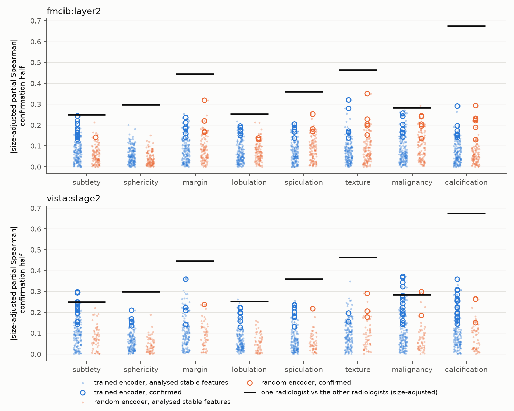
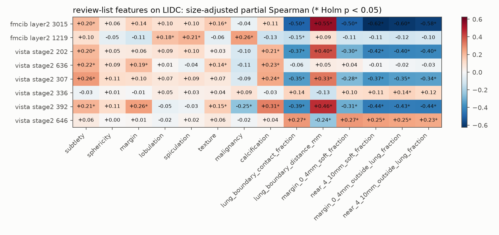

# Nodule SAE features compared with radiologist ratings on LIDC-IDRI

Run `20261019_sae_lidc` asks which stable features of the [nodule-interpretation dictionaries](../20261015_sae_nodule_coverage/README.md) (seed 2025; FMCIB layer2 `nodule75`, VISTA3D stage2 `nodule16x`) follow nodule characteristics rated by radiologists on an independent dataset, beyond nodule size and beyond the random-weight-encoder features. The rules were fixed in `configs/sae_lidc.json` before any LIDC activation was computed.

## Data

- **LIDC-IDRI** CT scans with slice thickness <= 2.5 mm. Annotations come from the pylidc database; annotations are grouped into nodules with pylidc, and a nodule enters when 3 or 4 radiologists annotated it.
  - 1,141 nodules from 582 patients. 26 scans were excluded: 13 annotations cannot be clustered by pylidc, 11 orientation is not axial, 2 irregular slice gaps.
  - One nodule per patient (most readers, then largest): 582 nodules, split by patient into 291 discovery and 291 confirmation nodules.
- **Crops:** 128 x 128 x 64 native voxels around the 50 % consensus centroid, voxels outside the scan set to -1024 HU. This is the rule of the LUNA25 crops used for the dictionaries, verified voxel by voxel against the official LUNA25 scans.
- **Ratings:** median over the readers of subtlety, sphericity, margin, lobulation, spiculation, texture and malignancy; for calcification, the fraction of readers who rated any calcification pattern.

## Procedure

- **Activations:** the crops pass through the same deployed inputs, frozen encoders, random-weight encoders and grid distance maps as the LUNA25 interpretation campaign. Recomputing six LUNA25 records along this path reproduced the cached arrays exactly. Each feature's target is its mean activation within 4 mm of the nodule surface or 4-10 mm outside it, whichever region was chosen on LUNA25 training patients.
- **Association:** partial Spearman correlation, i.e. the Pearson correlation of the ranks of target and rating after both are residualised on the rank of log consensus volume.
  - Discovery: a feature-rating pair is selected when the feature is active (target above 0) in at least 30 nodules of each half and its |correlation| exceeds the 95th percentile of the random-weight stable features for that rating.
  - Confirmation: the same sign and Benjamini-Hochberg q < 0.05 within the selected pairs.
  - Random-weight features go through the same steps.
- **Cross-seed replication:** the matched feature in each of the 7 other dictionary seeds has the same sign and p < 0.05 on the confirmation half; at least 6 of 7 are required.
- **Agreement between radiologists:** one reader drawn at random against the median of the others, size-adjusted in the same way, averaged over 200 draws. A feature compared with the median of all readers can exceed this value, because the median is more reliable than one reader.
- **Clear feature:** a confirmed, cross-seed replicated association of an active feature whose classifier effect ranks among the 50 largest (fixed LUNA25 classifier, [radiomics run](../20261017_sae_radiomics/README.md)).

## Results

| Site | Encoder | Stable | Analysed | Selected pairs | Confirmed pairs | Confirmed per analysed feature | Clear features |
|---|---|---:|---:|---:|---:|---:|---:|
| fmcib:layer2 | trained | 1,442 | 159 | 91 | 53 | 0.33 | 7 |
| fmcib:layer2 | random | 698 | 105 | 48 | 27 | 0.26 |  |
| vista:stage2 | trained | 207 | 140 | 122 | 76 | 0.54 | 10 |
| vista:stage2 | random | 54 | 52 | 24 | 9 | 0.17 |  |

| Site | Rating | Agreement between radiologists | Trained confirmed | Largest trained | Random confirmed | Largest random | Clear pairs |
|---|---|---:|---:|---:|---:|---:|---:|
| fmcib:layer2 | subtlety | 0.25 | 17 | 0.24 | 1 | 0.14 | 3 |
| fmcib:layer2 | sphericity | 0.30 | 0 |  | 0 |  | 0 |
| fmcib:layer2 | margin | 0.45 | 6 | 0.24 | 4 | 0.32 | 2 |
| fmcib:layer2 | lobulation | 0.25 | 5 | 0.20 | 2 | 0.14 | 0 |
| fmcib:layer2 | spiculation | 0.36 | 5 | 0.20 | 4 | 0.25 | 0 |
| fmcib:layer2 | texture | 0.46 | 5 | 0.32 | 5 | 0.35 | 3 |
| fmcib:layer2 | malignancy | 0.28 | 7 | 0.26 | 5 | 0.24 | 2 |
| fmcib:layer2 | calcification | 0.67 | 8 | 0.29 | 6 | 0.29 | 1 |
| vista:stage2 | subtlety | 0.25 | 14 | 0.30 | 0 |  | 7 |
| vista:stage2 | sphericity | 0.30 | 5 | 0.21 | 0 |  | 0 |
| vista:stage2 | margin | 0.45 | 4 | 0.36 | 1 | 0.24 | 1 |
| vista:stage2 | lobulation | 0.25 | 8 | 0.22 | 0 |  | 2 |
| vista:stage2 | spiculation | 0.36 | 7 | 0.24 | 1 | 0.22 | 1 |
| vista:stage2 | texture | 0.46 | 2 | 0.20 | 3 | 0.29 | 1 |
| vista:stage2 | malignancy | 0.28 | 17 | 0.37 | 2 | 0.30 | 3 |
| vista:stage2 | calcification | 0.67 | 19 | 0.36 | 2 | 0.26 | 7 |

- **Clear features:** 7 at fmcib:layer2 and 10 at vista:stage2. See `clear_features.csv`.
- **Prespecified review-list features:** the four LUNA25 contact descriptions hold on LIDC with the stated sign (size-adjusted, all nodules): fmcib:layer2 3015 with near 4-10 mm soft fraction -0.62 (Holm p 6.7e-62); vista:stage2 202 with margin 0-4 mm outside lung fraction -0.40 (Holm p 2.5e-22); vista:stage2 307 with near 4-10 mm outside lung fraction -0.34 (Holm p 4.9e-15); vista:stage2 392 with near 4-10 mm outside lung fraction -0.44 (Holm p 2.2e-26).

## Files

- `site_summary.csv`: nodules, analysed features, selected and confirmed pairs per site and encoder.
- `rating_summary.csv`: per rating, confirmed pairs and the largest confirmed |correlation| for trained and random-weight features, with the agreement between radiologists.
- `associations.csv`: every stable feature and rating: activity, discovery and confirmation correlations, selection, confirmation, replication, bootstrap interval and classifier effect rank.
- `clear_features.csv`, `clear_summary.csv`: the clear feature-rating pairs and one row per clear feature.
- `prespecified.csv`: the eight review-list features against all ratings and contact measures, with Holm-adjusted p-values.
- `ceiling.csv`: agreement between radiologists per rating.
- `provenance.json`: settings, counts and source hashes.
