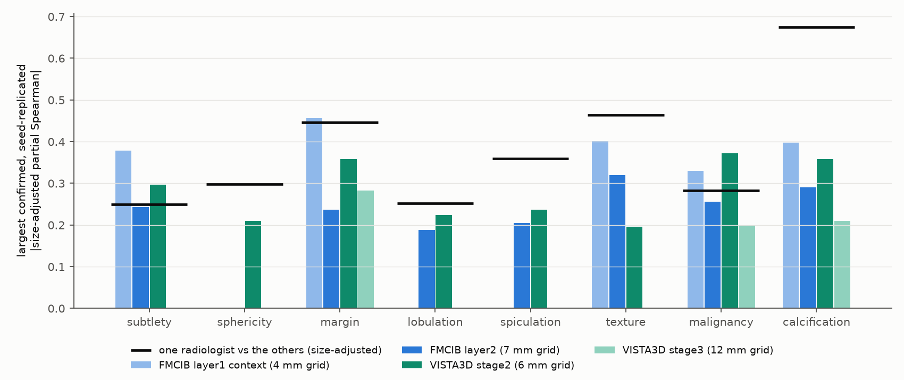
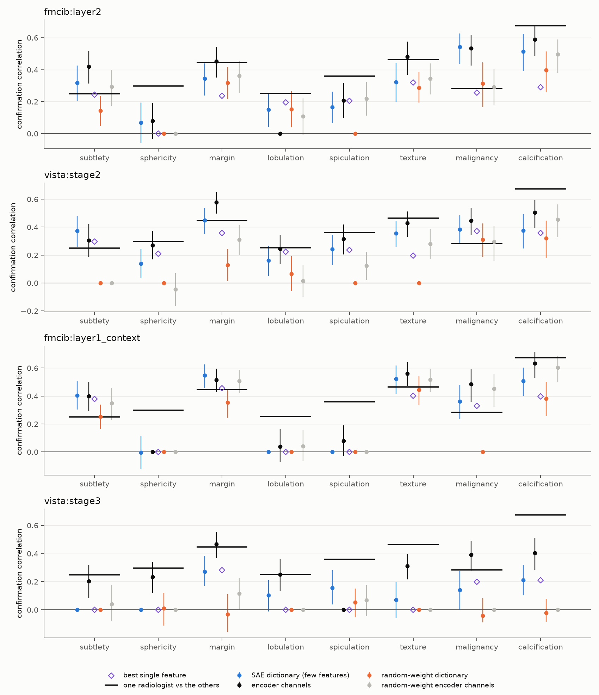

# Follow-up of the LIDC radiologist-rating check: feature pages, finer and coarser sites, and dictionary probes

Run `20261020_sae_lidc_followup` continues [the LIDC check](../20261019_sae_lidc/README.md). Rules were fixed in `configs/sae_lidc_followup.json` before any result; two amendments made before any reader judgement or task item are recorded there.

## Feature pages and reader pass

- **Pages:** for each of the 17 clear features, the 12 highest-activation nodules of the LIDC discovery half and of the LUNA25 training patients, each against a volume-matched low-activation nodule, with the activation map on an axial slice.
- **Pairing rule:** the low partner is the nodule with the lowest activation among the 10 unused nodules nearest in volume. The first rule drew partners from the lowest 20 % of activations, which left the groups unmatched in size.
- **Consistency:** at 30 nodules per group, every confirmed rating of every clear feature differs between high and low nodules in the confirmed direction (`consistency.csv`).
- **Reader pass:** after viewing every page, six features were kept for a blinded reader task.

| Feature | Pattern of the high-activation nodules |
|---|---|
| vista:stage2 202 | solid nodule lying free in aerated lung, activation centred on the nodule; low nodules touch pleura, fissure or mediastinum, or are ground-glass |
| fmcib:layer2 3015 | small solid well-circumscribed nodule fully surrounded by aerated lung, activation centred on the nodule; low nodules of the same size touch the chest wall |
| vista:stage2 182 | irregular, heterogeneous nodules (part-solid, lobulated or spiculated); low nodules are smooth, round and homogeneous, several calcified |
| vista:stage2 743 | small, very dense, sharply defined nodules, often calcified, activation centred on the nodule; low nodules are faint or ground-glass of the same size |
| vista:stage2 392 | dense solid nodules, many calcified, lying free in lung, activation 4-10 mm below and right of the nodule; low nodules are faint, ground-glass or attached to the wall |
| fmcib:layer2 507 | faint, ground-glass or ill-defined small nodules deep in the lung; activation fills the surrounding aerated lung; low nodules are small, solid and near the chest wall |

The remaining features were set aside for one of these reasons:
- the activation lies on the pleura or chest wall;
- the activation sits at a fixed position of the field;
- the high and low groups show no visible difference;
- the feature repeats a kept pattern.

Several kept features respond on one side of the nodule or in the lung around it, so their maps mark where the feature fires, not the finding.

## Finer and coarser sites

The same rules were applied to the FMCIB layer1 complete-context dictionary (4 mm grid) and the VISTA3D stage3 dictionary (12 mm grid); the classifier-effect criterion is not applied there.

| Rating | FMCIB layer1 context (4 mm) | FMCIB layer2 (7 mm) | VISTA3D stage2 (6 mm) | VISTA3D stage3 (12 mm) | One radiologist vs the others |
|---|---|---:|---:|---:|---:|
| subtlety | 0.38 | 0.24 | 0.30 |  | 0.25 |
| sphericity |  |  | 0.21 |  | 0.30 |
| margin | 0.46 | 0.24 | 0.36 | 0.28 | 0.45 |
| lobulation |  | 0.19 | 0.22 |  | 0.25 |
| spiculation |  | 0.20 | 0.24 |  | 0.36 |
| texture | 0.40 | 0.32 | 0.20 |  | 0.46 |
| malignancy | 0.33 | 0.26 | 0.37 | 0.20 | 0.28 |
| calcification | 0.40 | 0.29 | 0.36 | 0.21 | 0.67 |

## Dictionary probes

A lasso on the discovery half predicts each size-adjusted rating from the inputs below; the prediction is correlated with the rating on the confirmation half:
- every stable feature of the dictionary;
- the raw encoder channels;
- the random-weight dictionary;
- the random-weight encoder channels.

| Site | Rating | Dictionary | Encoder channels | Random-weight dictionary | Random-weight channels |
|---|---|---:|---:|---:|---:|
| fmcib:layer2 | subtlety | 0.32 | 0.42 | 0.14 | 0.29 |
| fmcib:layer2 | sphericity | 0.07 | 0.08 | 0.00 | 0.00 |
| fmcib:layer2 | margin | 0.34 | 0.45 | 0.32 | 0.36 |
| fmcib:layer2 | lobulation | 0.15 | 0.00 | 0.15 | 0.11 |
| fmcib:layer2 | spiculation | 0.17 | 0.21 | 0.00 | 0.22 |
| fmcib:layer2 | texture | 0.32 | 0.48 | 0.29 | 0.34 |
| fmcib:layer2 | malignancy | 0.54 | 0.53 | 0.31 | 0.29 |
| fmcib:layer2 | calcification | 0.51 | 0.59 | 0.40 | 0.50 |
| vista:stage2 | subtlety | 0.37 | 0.30 | 0.00 | 0.00 |
| vista:stage2 | sphericity | 0.14 | 0.27 | 0.00 | -0.05 |
| vista:stage2 | margin | 0.45 | 0.58 | 0.13 | 0.31 |
| vista:stage2 | lobulation | 0.16 | 0.25 | 0.06 | 0.02 |
| vista:stage2 | spiculation | 0.24 | 0.32 | 0.00 | 0.12 |
| vista:stage2 | texture | 0.36 | 0.43 | 0.00 | 0.28 |
| vista:stage2 | malignancy | 0.38 | 0.45 | 0.31 | 0.29 |
| vista:stage2 | calcification | 0.38 | 0.50 | 0.32 | 0.45 |
| fmcib:layer1_context | subtlety | 0.41 | 0.40 | 0.25 | 0.35 |
| fmcib:layer1_context | sphericity | -0.00 | 0.00 | 0.00 | 0.00 |
| fmcib:layer1_context | margin | 0.55 | 0.51 | 0.35 | 0.51 |
| fmcib:layer1_context | lobulation | 0.00 | 0.04 | 0.00 | 0.04 |
| fmcib:layer1_context | spiculation | 0.00 | 0.08 | 0.00 | 0.00 |
| fmcib:layer1_context | texture | 0.52 | 0.56 | 0.44 | 0.52 |
| fmcib:layer1_context | malignancy | 0.36 | 0.49 | 0.00 | 0.45 |
| fmcib:layer1_context | calcification | 0.51 | 0.63 | 0.38 | 0.60 |
| vista:stage3 | subtlety | 0.00 | 0.20 | 0.00 | 0.04 |
| vista:stage3 | sphericity | 0.00 | 0.23 | 0.01 | 0.00 |
| vista:stage3 | margin | 0.27 | 0.47 | -0.03 | 0.11 |
| vista:stage3 | lobulation | 0.10 | 0.25 | 0.00 | 0.00 |
| vista:stage3 | spiculation | 0.16 | 0.00 | 0.05 | 0.07 |
| vista:stage3 | texture | 0.07 | 0.31 | 0.00 | 0.00 |
| vista:stage3 | malignancy | 0.14 | 0.39 | -0.04 | 0.00 |
| vista:stage3 | calcification | 0.21 | 0.40 | -0.02 | 0.00 |

## Files

- `consistency.csv`: high against volume-matched low nodules (30 each) for every confirmed rating, and the LUNA25 malignant share.
- `reader_decisions.csv`: the kept features and the reasons for the others.
- `resolution.csv`: confirmed and seed-replicated associations per site and rating, for trained and random-weight features.
- `associations_extra_sites.csv`: all feature-rating results at the two added sites.
- `probe.csv`: probe correlations with bootstrap intervals and the number of selected inputs.
- `provenance.json`: settings and source hashes.

Pages and reader-task images show individual scans and stay in local storage.
