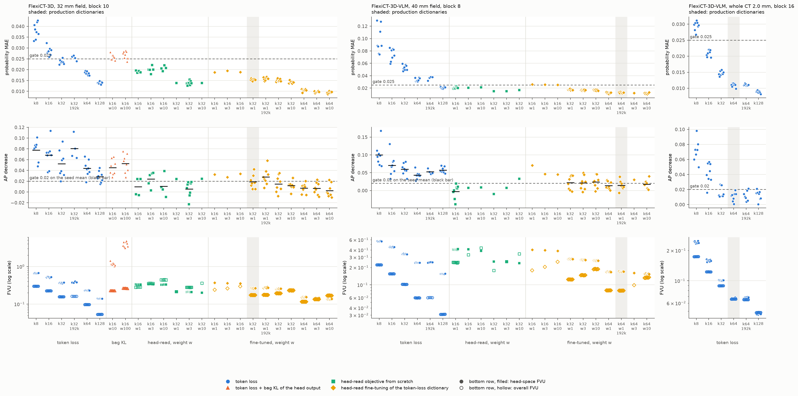
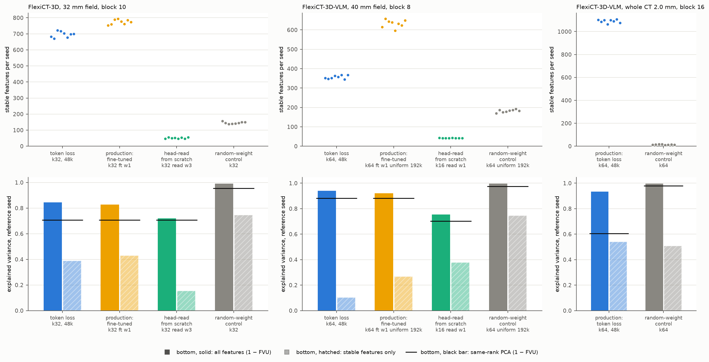

# FlexiCT sparse autoencoders for interpretation (campaign 20261021_flexict_sae)

Sparse autoencoders (BatchTopK, expansion 4, 8 seeds) on three FlexiCT representations of the official LUNA25 CTs. The development fold selected every dictionary; the test fold was not used.

| Site | Representation | Read by |
|---|---|---|
| `f32_b10` | FlexiCT-3D, 32 mm nodule field, patch tokens after block 10 of 16 (6×6×6 tokens) | the selected FlexiCT-3D malignancy classifier (max head over all 216 tokens) |
| `f40_b08` | FlexiCT-3D-VLM image encoder, 40 mm field, block 8 | the selected VLM-encoder classifier (max head) |
| `w20_b16` | FlexiCT-3D-VLM image encoder, official CT-RATE whole-CT window (2.0 mm, 160³), final block 16 | the text-aligned image embedding; a max head on the 3³ tokens nearest the nodule |

## Production dictionaries

| Site | Configuration | Seeds passing the classifier gate | Stable features per seed (random-weight control) | Reference FVU / same-rank PCA |
|---|---|---|---|---|
| `w20_b16` | k64, token loss, 48,000 steps | 8 of 8 (per seed); text fidelity 8 of 8 | 1,063–1,108 (10–18) | 0.065 / 0.395 |
| `f32_b10` | k32, token-loss dictionary fine-tuned with the head-read terms (weight 1), 48,000 + 8,000 steps | gate met (MAE and AUROC on every seed, mean AP decrease 0.019) | 752–793 (137–157) | 0.172 / 0.294 |
| `f40_b08` | k64, token-loss dictionary fine-tuned with the head-read terms (weight 1), 192,000 + 8,000 steps | gate met (MAE and AUROC on every seed, mean AP decrease 0.015) | 596–657 (169–192) | 0.080 / 0.117 |

- Stable features reappear (decoder cosine ≥ 0.7) in at least 6 of the 7 other seeds.
- The fixed-classifier gate replaces every token the deployed seed-2025 head reads by its reconstruction, on all 1,285 development nodules. The limits are probability MAE ≤ 0.025, AUROC decrease ≤ 0.01 and AP decrease ≤ 0.02.
  - At `w20_b16` every limit holds on every seed. At the two field sites, MAE and AUROC hold on every seed and AP is judged on the mean over the 8 seeds.
  - The development AP (113 malignant nodules) has a patient-bootstrap SD of about 0.06, and retraining the head with another seed changes it by up to 0.027.
- Text fidelity at `w20_b16`: with every patch token reconstructed, the CT-RATE image embedding keeps cosine 0.9994–0.9995 to the original, and concept-score Spearman correlations have a median of 0.999.
- Reproducible share of the representation: stable features explain 0.539 (`w20_b16`), 0.430 (`f32_b10`) and 0.268 (`f40_b08`) of the reference seed's development variance. For tokens inside the nodule or within 4 mm of its surface the shares are 0.329, 0.338 and 0.071.

## Why the field sites need fine-tuning

- With the token loss alone, no k from 8 to 128 met the gate at the field sites (top rows, blue).
  - The max heads read directions that the token loss reconstructs poorly. Error inside the head's 128-dimensional read subspace is 2–5 times the overall error (bottom row; filled = head-space FVU, hollow = overall FVU).
  - The maximum over 216 tokens amplifies that error.
- Adding the KL between the head's outputs on 16 training bags per step (orange) fitted the 3,729 training bags without carrying to development nodules, and it scrambled the head's internal maxima.
- The head-read terms (head-space FVU of every token plus the error of the head's 128 per-bag maxima) met the gate when trained from scratch (green). Their features, however, did not reappear across seeds: 41–56 stable features, against 621–721 for the token-loss dictionaries at the same site and k (f32_b10 k32, f40_b08 k16).
- Fine-tuning each seed's token-loss dictionary with the head-read terms for 8,000 steps (yellow) met the gate and kept, or raised, the stable decomposition (`sae_quality.png`).

## Files

- `runs.csv`: every trained dictionary (431), with development FVU, cosine, L0, the gate values, head-space and pooled FVU, and text fidelity at `w20_b16`. The `passes` column is the per-seed gate.
- `groups.csv`: per group of seeds, stable features, explained variance by stable features, same-rank PCA FVU, and nodule-region coverage where computed.
- `summary.json`: production verdicts, the selection rules and the field-site gate revision.
- `provenance.json`: code and configuration hashes.

The dictionaries, per-nodule statistics and checkpoints stay private.
